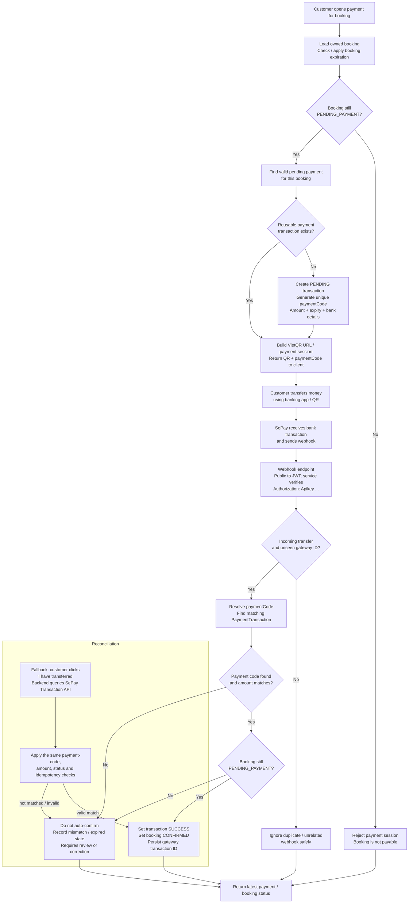

# Hotel Hub

Hotel Hub is the hotel booking platform backend for managing guest reservations, room inventory, payments, and operational workflows. The system is designed around a layered Spring Boot architecture and emphasizes transactional integrity for inventory reservation and payment confirmation.

## Overview

- Hotels, rooms, and inventory are managed through JPA entities and repositories.
- Booking creation validates idempotency, room availability, and date range integrity before reserving inventory.
- Inventory reservation uses optimistic locking with `DailyInventory.@Version` and retries failed transactions safely.
- Payment creation supports pending payment states, SePay webhook verification, and reconciliation for delayed or missed webhook events.
- Expired unpaid bookings are cleaned up by scheduled jobs that release inventory and update booking state.

## Architecture

The backend follows a layered design:

- REST controllers handle incoming API requests from web clients and partner integrations.
- Application services contain business logic for authentication, hotel search, booking, payment, and expiration flows.
- Repositories manage persistence for bookings, payment transactions, daily inventory, and related entities.
- PostgreSQL stores the source-of-truth transactional data.
- SePay and VietQR/QR payment flows integrate with the platform through webhook and API-based reconciliation.

## Booking flow | Inventory reservation & concurrency control

```mermaid
flowchart TD
    A[Customer submits booking request] --> B[Check idempotency key<br/>(userId + key)]
    B --> C{Existing booking<br/>for this key?}

    C -->|Yes| D[Return existing booking<br/>(no second reservation)]
    C -->|No| E[Validate user, dates, rooms, guests<br/>and primary contact]
    E --> F[Start a fresh transaction<br/>(createBookingOnce via Spring proxy)]
    F --> G[Load DailyInventory rows<br/>for every date in the stay]
    G --> H{Stay dates open and<br/>inventory range complete?}

    H -->|No| I[Reject booking<br/>Return conflict / validation error]
    H -->|Yes| J{Enough rooms available?<br/>availableRooms - blockedRooms >= quantity}

    J -->|Yes| K[Increase blockedRooms<br/>for each stay date<br/>DailyInventory uses @Version]
    K --> L[Persist Booking + Contact + Items<br/>Calculate total price<br/>Set PENDING_PAYMENT / expiry]
    L --> M[Flush / commit transaction<br/>Database checks @Version]
    M --> N{Optimistic-lock<br/>conflict?}

    N -->|No| O[Commit succeeds]
    O --> P[Return booking response<br/>Continue to payment]

    N -->|Yes| Q[Rollback failed attempt<br/>Wait briefly; retry in a fresh transaction<br/>Maximum 3 attempts]
    Q --> R{Attempts exhausted?}
    R -->|No| F
    R -->|Yes| S[Return CONFLICT<br/>Ask customer to try again]

    J -->|No| I
```

### Booking implementation notes

- Booking creation checks an idempotency key before creating a second reservation.
- Inventory is loaded per stay date and validated before reservation.
- `DailyInventory.@Version` protects the inventory reservation from race conditions.
- Failed optimistic-lock attempts are rolled back and retried in a fresh transaction up to three times.
- If all attempts fail, the API returns a `CONFLICT` response to the customer.

## Payment flow | VietQR + SePay webhook & reconciliation



### Payment implementation notes

- Payment sessions are created only for bookings still in `PENDING_PAYMENT` state.
- A reusable payment transaction is reused when the same booking still has a valid pending payment record.
- SePay webhook requests are publicly reachable but are validated by the payment service using the configured API key.
- Payment confirmation checks the incoming transfer type, gateway transaction identity, payment code, amount match, and whether the booking is still payable.
- Customer-triggered reconciliation reuses the same validation checks when a webhook is delayed or missed.
- Overdue unpaid bookings are reconciled by the scheduled expiration job, which releases inventory and keeps booking state consistent.

## Database and transactional integrity

The application stores essential operational data in PostgreSQL with strong consistency rules:

- Users and roles
- Hotels and room inventory
- DailyInventory availability rows
- Bookings, booking contacts, and booking items
- Payment transactions and gateway metadata
- Expiration and reconciliation records

Core design rule: transactional critical paths must be atomic and idempotent, especially booking creation and payment confirmation.

## API documentation and testing

The project includes backend documentation and test automation support for local and pre-deploy verification.

- Postman collections for smoke testing the booking and payment flows
- Local environment configuration for JWT-based auth and payment mock/debug flows
- Manual database workflow notes for schema-safe updates

## Repository structure

- `backend/` — Spring Boot backend application and business logic
- `docs/` — DB, Postman, and diagram docs
- `README.md` — project overview and workflow documentation

## Relevant implementation source files

- `backend/src/main/java/com/hotel/hotel_backend/security/SecurityConfig.java`
- `backend/src/main/java/com/hotel/hotel_backend/security/JwtAuthFilter.java`
- `backend/src/main/java/com/hotel/hotel_backend/service/impl/BookingServiceImpl.java`
- `backend/src/main/java/com/hotel/hotel_backend/service/impl/InventoryServiceImpl.java`
- `backend/src/main/java/com/hotel/hotel_backend/entity/DailyInventory.java`
- `backend/src/main/java/com/hotel/hotel_backend/service/BookingPaymentGatewayService.java`
- `backend/src/main/java/com/hotel/hotel_backend/controller/PaymentWebhookController.java`
- `backend/src/main/java/com/hotel/hotel_backend/service/BookingExpirationService.java`

---

This README summarizes the real implemented flow for the hotel booking platform and reflects the current backend design used by the project.
