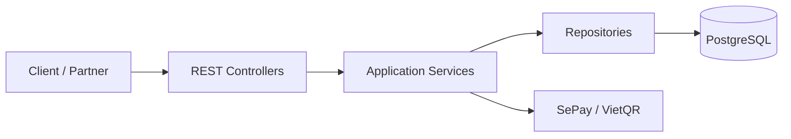
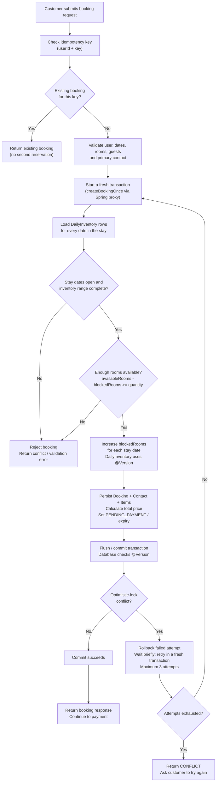
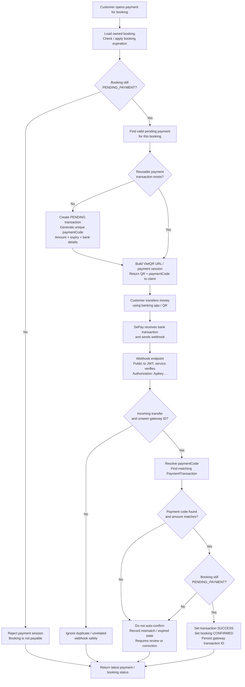

# Hotel Booking Platform – Architecture & Flow Diagrams

These diagrams document the backend implementation in the `main` branch.

## 1. Backend architecture

## 2. Booking and inventory reservation flow

## 3. VietQR / SePay payment flow

## Implementation notes

- This is shown as a layered Spring Boot backend, not a microservices architecture.
- Booking creation checks idempotency before inventory reservation.
- Inventory reservation uses `DailyInventory.@Version`; optimistic-lock failures cause the current attempt to roll back and the wrapper retries in a fresh transaction, up to three attempts.
- SePay webhook requests do not authenticate as an end-user JWT request; the payment service separately validates the configured SePay API key.
- Payment confirmation checks incoming transfer type, gateway transaction identity, payment code, amount, and whether the booking is still payable.
- The customer-triggered reconciliation path queries SePay's Transaction API and reuses the payment confirmation checks.
- Scheduled expiration releases inventory for overdue unpaid bookings. Each booking expiration is isolated in a `REQUIRES_NEW` transaction.

## Source files used for the diagrams

- `backend/src/main/java/com/hotel/hotel_backend/security/SecurityConfig.java`
- `backend/src/main/java/com/hotel/hotel_backend/security/JwtAuthFilter.java`
- `backend/src/main/java/com/hotel/hotel_backend/security/JwtService.java`
- `backend/src/main/java/com/hotel/hotel_backend/service/impl/BookingServiceImpl.java`
- `backend/src/main/java/com/hotel/hotel_backend/service/impl/InventoryServiceImpl.java`
- `backend/src/main/java/com/hotel/hotel_backend/entity/DailyInventory.java`
- `backend/src/main/java/com/hotel/hotel_backend/service/BookingPaymentGatewayService.java`
- `backend/src/main/java/com/hotel/hotel_backend/controller/PaymentWebhookController.java`
- `backend/src/main/java/com/hotel/hotel_backend/service/BookingExpirationService.java`
